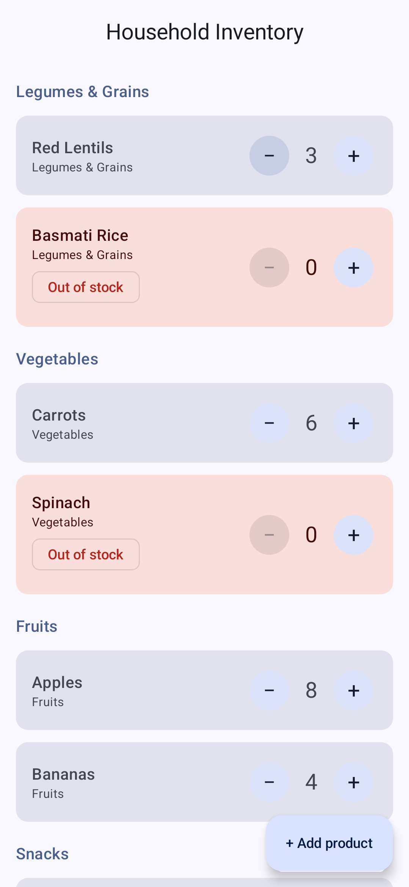
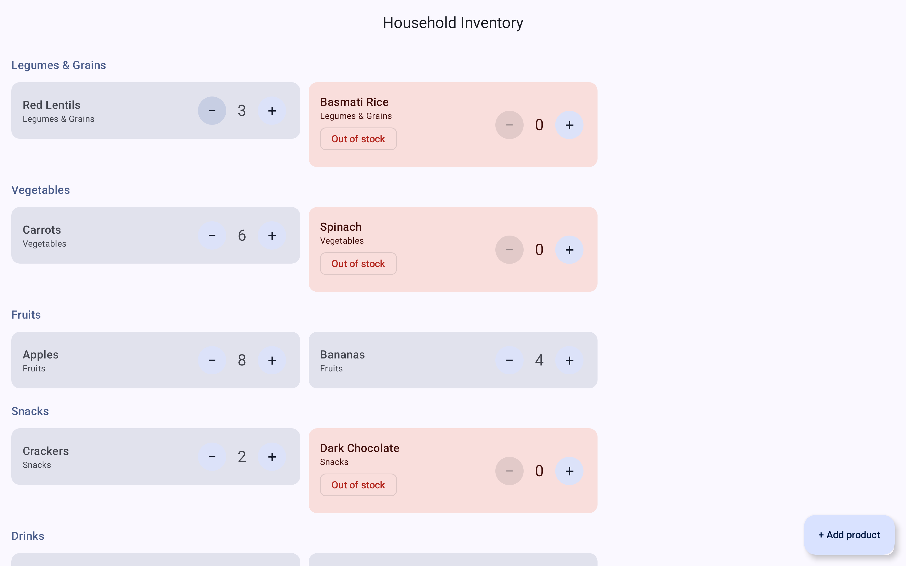

# Android Agent UI Verification Lab

### Can AI coding agents independently verify the Android interfaces they generate?

**Case Study 001 · HomeStock · Claude Code × Android CLI × Jetpack Compose**

AI-generated code that compiles is not necessarily a UI that has been verified. This project documents what happened when an AI coding agent was asked to **build, render, visually inspect, and assess the accessibility** of a real Jetpack Compose screen—with and without access to Android CLI.

**The central finding:** access to an Android-specific tool did not guarantee that the agent would choose the right workflow. With explicit guidance, Android CLI produced inspectable Compose Preview images and component-tree data; that structured evidence helped correct an earlier, incorrect visual diagnosis.

> [!IMPORTANT]
> **An exploratory engineering case study, not a performance benchmark.** Each experiment was run once on one Mac, with different tool paths and no control for caching or other environmental factors. Times, tokens, and costs are recorded for transparency—not to rank tools, models, or workflows.

## What we learned

| Question | Observation | Evidence |
|---|---|---|
| Can the agent build a Compose screen? | Both code-generation runs produced Android code that built successfully. | [Code-generation prompts](prompts/code-generation.md) · [Comparison](results/comparison.md) |
| Does installing Android CLI make the agent use it? | **Not necessarily.** In B2 the agent loaded the Android CLI skill but chose an Android Studio rendering route, which failed in the observed environment. | [Verification prompts](prompts/ui-verification.md) |
| Can Android CLI support visual verification? | **Yes, when explicitly directed.** The agent rendered phone and tablet Compose Previews and inspected their PNGs. | [Original B2 findings](ANDROID_CLI_BENCHMARK_FINDINGS.md) |
| Does structured UI evidence change the diagnosis? | **Yes in this case.** The agent initially treated empty tablet space as a broken two-column grid; the component tree showed three column slots with too few products to fill the third. | [Comparison and correction](results/comparison.md) |
| Can the agent evaluate accessibility from images alone? | **Only partially.** Component trees exposed missing semantic labels and headings; TalkBack behavior, focus order, contrast, and touch targets still require separate verification. | [B2 findings](ANDROID_CLI_BENCHMARK_FINDINGS.md) |

## The UI under test

**HomeStock** is a small household-inventory app built with Kotlin and Jetpack Compose. It groups products into six categories and supports quantity adjustments, out-of-stock states, and an Add Product dialog.

These are **Android CLI Compose Preview renders from the user-guided B2 retry**, not screenshots from the autonomous A2 emulator run.

<table>
  <tr>
    <th align="center">Phone · 411 × 891 dp</th>
    <th align="center">Tablet · 1280 × 800 dp</th>
  </tr>
  <tr>
    <td align="center"></td>
    <td align="center"></td>
  </tr>
</table>

The archived A2 emulator screenshots are also available under [`results/artifacts/`](results/artifacts/). **A2 and B2 images were produced by different rendering methods and must not be compared pixel for pixel.** See the [artifact provenance and checksums](results/artifacts/PROVENANCE.md).

## Experiment design

| Phase | Starting point | Android CLI access | What happened |
|---|---|---|---|
| **Test A** · code generation | Baseline commit `0202cb3` | Disallowed | Generated HomeStock UI; build succeeded. Resulting source: `77fe81a`. |
| **Test B** · code generation | Same baseline | Allowed | Generated HomeStock UI; build succeeded. The agent did not run Android CLI preview commands. Resulting source: `1f95f80`. |
| **Test A2** · UI verification | Test B code, commit `1f95f80` | Disallowed | Two interrupted attempts, then a completed autonomous run using emulator screenshots. |
| **Test B2** · UI verification | Same Test B code | Allowed | The autonomous Studio rendering route failed; the subsequent Android CLI previews and component-tree inspection succeeded **after user guidance**. |

**Why both A2 and B2 use Test B's code:** the verification worktrees were deliberately created from the same `1f95f80` starting commit. They did **not** each verify the code generated in their corresponding A/B run. The original source snapshots are documented in [`experiments/README.md`](experiments/README.md).

### Autonomous behavior vs. assisted recovery

The difference is central to the study:

1. **Autonomous B2 attempt:** the agent loaded the Android CLI skill, selected an Android Studio–based rendering command, and encountered `Failed to get module` / `File does not exist` because of the IDE's open-project state.
2. **Assisted retry 1:** the user provided the standalone `android preview list` and `android preview render` commands. Both preview images were generated and inspected.
3. **Assisted retry 2:** the user explicitly requested `--component-tree`; the agent inspected the structured output and revised its tablet-grid finding.

**A successful assisted retry is not evidence that the agent would have discovered the working CLI commands without help.** The failure also does not demonstrate that Android CLI itself was incapable of rendering the UI.

## Observed results

| Run | Outcome | Reported command interval* |
|---|---|---:|
| A2 · completed autonomous attempt | Phone + tablet **emulator screenshots** inspected | ~57 s |
| B2 · autonomous attempt | Studio preview rendering failed; no images inspected | ~49 s |
| B2 · assisted CLI retry 1 | Phone + tablet **Compose Preview PNGs** rendered and inspected | ~17 s |
| B2 · assisted CLI retry 2 | PNGs + component-tree JSON inspected | Not timed |

\*These intervals cover different operations, are not full session durations, and were not measured under comparable conditions. **Do not use them to claim that one tool is faster.** Whole-session token, cache, and cost records—including interrupted A2 attempts and B2's five-prompt session—are preserved in the [detailed comparison](results/comparison.md) and [prompt records](prompts/).

### What visual verification found—and corrected

- **Phone:** the extended Add Product button obscured some initially visible content. The screen could scroll; this is a visual observation, not a verified touch-interaction failure.
- **Tablet:** card heights differed when an out-of-stock chip was present. The initial claim that the adaptive grid used only two columns was **incorrect**: the component tree showed three slots, with the third empty because of the sample data.
- **Accessibility semantics:** product quantity `−` / `+` controls lacked product-specific descriptions; category titles were not marked as headings; an out-of-stock status appeared as a disabled button.
- **Not established:** actual TalkBack announcements and focus traversal, measured color contrast, minimum touch-target sizes, large-font behavior, dark mode, and dialog accessibility.

See the [unaltered original B2 findings](ANDROID_CLI_BENCHMARK_FINDINGS.md), including observations superseded by later evidence.

## Reproduce the verification

### Prerequisites

The experiment was conducted on **macOS 15.6.1 (Apple silicon)** with **Claude Code 2.1.312**, `claude-sonnet-5-5`, **Android CLI 1.1.16717390** and its Claude plugin `1.0.16625370`, **Gradle 9.6.0**, **JDK 25**, **AGP 9.4.1**, **Kotlin 2.2.10**, and **Android SDK Platform 37**. Other OS/tool combinations were not tested.

Install a compatible Android SDK and JDK. Configure `ANDROID_HOME`, or create a local `local.properties` file (which is ignored by Git):

```properties
sdk.dir=/absolute/path/to/your/Android/Sdk
```

The Gradle daemon configuration requests **Java 25**. Dependencies must be available online or already cached; a clean-machine install and cold-cache build were not tested.

### Build the runnable app

```bash
./gradlew :app:assembleDebug
```

The **published root app** keeps the Test B Kotlin code but replaces the original launcher artwork with a separately created storage-box icon. That change was checked: the root app built successfully and re-rendered phone and tablet PNGs with **SHA-256 values identical** to the archived B2 preview images. The original launcher images are intentionally not redistributed.

### Render both Compose Previews with Android CLI

From the repository root, with a compatible `android` executable available on `PATH`:

```bash
android preview list :app

android preview render :app \
  --fqn com.perimamoglu.homestockbenchmark.InventoryScreenKt.InventoryPhonePreview \
  --output=./Phone.png

android preview render :app \
  --fqn com.perimamoglu.homestockbenchmark.InventoryScreenKt.InventoryTabletPreview \
  --output=./Tablet.png
```

For structured semantics data, check your installed CLI's syntax with `android preview render --help` and use its `--component-tree` option with the relevant preview FQNs. The case-study command form is recorded in [`prompts/ui-verification.md`](prompts/ui-verification.md). JSON child/action ordering can differ between runs even when the semantic content matches; a reproduction matched **267 phone nodes and 365 tablet nodes** after normalizing ordering.

For the **no-CLI emulator approach**, see the [original comparison and method](results/comparison.md). Unlike Compose Preview rendering, that route uses an Android emulator, `adb` and screenshots. Reset any emulator display-size and density overrides after the test.

### What can and cannot be reproduced

- **Can:** build the published HomeStock app, render the Test B phone/tablet Previews, inspect the archived PNGs and component-tree files, and study the agent prompts and observations.
- **Partially:** rebuild Test A or Test B sources using the root Gradle configuration **after supplying replacement launcher icons**; the archived snapshots intentionally omit 14 original icon assets.
- **Cannot exactly reproduce from this repository alone:** the original baseline `0202cb3` and its private Git history, complete original icon assets, the private Claude session transcripts and settings, or an identical clean-environment A/B run.

The published source snapshots retain all non-icon files identical to their recorded original commits. Their omissions are documented in [`experiments/README.md`](experiments/README.md) and each `OMITTED_ASSETS.md` manifest.

## Repository guide

| Location | Purpose |
|---|---|
| [`app/`](app/) + Gradle files | Runnable HomeStock app with original Kotlin code and replacement launcher icon |
| [`experiments/`](experiments/) | Archival Test A / Test B source snapshots and omitted-asset manifests |
| [`prompts/code-generation.md`](prompts/code-generation.md) | Recovered verbatim code-generation prompts and session evidence |
| [`prompts/ui-verification.md`](prompts/ui-verification.md) | Recovered A2/B2 prompts, interruptions and assisted retries |
| [`results/comparison.md`](results/comparison.md) | Timings, token/cost records, evidence contradictions and methodological caveats |
| [`results/artifacts/`](results/artifacts/) | A2 emulator screenshots, B2 CLI PNGs, component-tree JSON and checksums |
| [`ANDROID_CLI_BENCHMARK_FINDINGS.md`](ANDROID_CLI_BENCHMARK_FINDINGS.md) | Original B2 analysis, retained unchanged |
| [`NOTICE`](NOTICE) | Third-party/template provenance and license exceptions |

## Limitations and research integrity

This is **one exploratory case study**, not a statistically powered benchmark. No repeated trials, randomized order, clean-machine verification, or cold-cache controls were performed. A2's completed route and B2's assisted route use different rendering systems; permission settings and tool availability also differed. The B2 failure was tied to Android Studio project state, and the recovery required explicit user direction.

The agent's visual interpretations were not independently evaluated against a formal UI defect ground truth. The structured tree corrected one claim, but **semantics-tree inspection does not substitute for TalkBack testing**. The original report remains untouched so readers can trace how the conclusions developed.

Only selected evidence is public: prompts, source snapshots, generated images, component-tree outputs, provenance and summarized usage data. Private agent transcripts, raw logs and the full Android CLI skill text are not redistributed. Original experiment commit IDs refer to a **separate local Git repository**, not the history of this public repository.

## Licensing and attribution

This repository uses **different licenses for different materials**:

| Material | Terms |
|---|---|
| Project-created code (`InventoryScreen.kt`, `MainActivity.kt`) and replacement storage-box icon | [Apache License 2.0](LICENSE), to the extent the author can license these works |
| Documentation, recovered prompts, research findings, screenshots and component-tree artifacts | [Creative Commons Attribution 4.0 International](LICENSE-docs), subject to third-party rights |
| Gradle wrapper, template-derived files and other third-party content | Their own terms, or provenance not fully verified; see [NOTICE](NOTICE) |

**The original launcher icon assets are not distributed.** Their rights could not be verified, so they were removed from the runnable app and both archival snapshots; each omitted original asset is recorded by path and checksum. The 12 remaining template boilerplate files and portions of the Gradle configuration have unverified individual provenance. The repository licenses do not override third-party rights. Copyright treatment of AI-generated code may vary by jurisdiction. See [NOTICE](NOTICE) and [`experiments/README.md`](experiments/README.md) for the complete disclosures.

## Next questions

- Can agents discover the correct Android verification tools consistently across **multiple runs** and environments?
- How often do screenshots alone produce **false UI diagnoses**, and when does component-tree evidence correct them?
- Which Compose accessibility defects are identifiable from semantics data, and which require **on-device TalkBack testing**?
- Can future case studies use seeded, known defects to quantify **detection, misses and false positives**?

Contributions, independent reproductions and constructive critiques are welcome. When reporting a reproduction, include your tool versions, starting source, exact prompts, CLI commands, artifacts and environmental constraints.

---

**Case Study 001: HomeStock** · An evidence-first look at what an Android AI coding agent actually verified—and what it did not.
